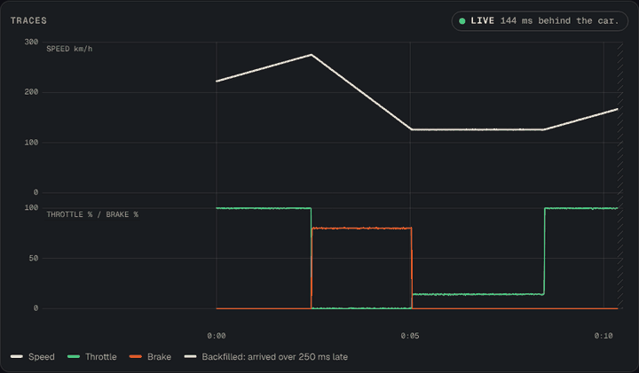
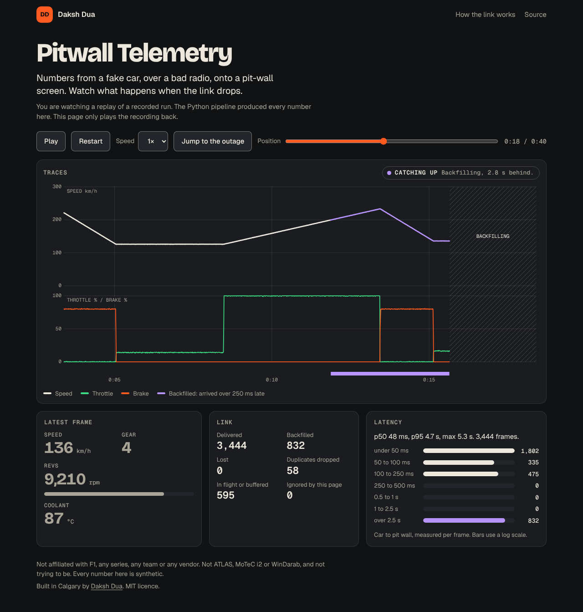

# Pitwall Telemetry

**A race telemetry pipeline in miniature: CAN frames from a fake car, over a bad radio link, onto a pit-wall screen.**

[**Watch the replay**](https://daksh2197.github.io/pitwall-telemetry/) in any browser. Free, no sign-up. It plays a recorded run with a five-second outage in the middle.

[](https://github.com/daksh2197/pitwall-telemetry/actions/workflows/ship.yml)
[](LICENSE)

<p align="center">
  
</p>

Not affiliated with F1, any series, any team or any vendor. Not ATLAS, MoTeC i2 or WinDarab, and not trying to be.

## Why I built it

I have not worked in motorsport yet. I log my own car over OBD-II. The part of race engineering I can teach myself at a desk is the plumbing: getting numbers from the car to the people deciding, over a link that will fail at the worst moment. So I built the plumbing, small, and measured it.

## What it does

- **Drives a fake lap.** A seed picks six corners and how hard the driver takes each one. The simulator turns that into speed, throttle, brake, steering, gear, revs and coolant temperature, a millisecond at a time. It is a made-up track and a made-up car.
- **Speaks CAN.** Three messages go out as raw 8-byte frames: engine and chassis at 100 Hz, drivetrain at 20 Hz. That is 220 frames a second. The layout lives in [`dbc/pitwall.dbc`](dbc/pitwall.dbc), a file I wrote for this project.
- **Sends them over a bad link.** The link loses packets at random, delays them, shuffles them with jitter and goes dark for whole stretches.
- **Keeps what it could not send.** The car numbers every frame and holds the unconfirmed ones in a ring buffer. When the link comes back it sends the backlog in order. Nothing arrives twice. Nothing arrives out of order. If the buffer overflows, the oldest frames go and every one is counted.
- **Decodes at the pit wall.** [`cantools`](https://github.com/cantools/cantools) reads the DBC and turns bytes back into km/h and percent.
- **Shows it live.** Speed, throttle and brake traces, a rev bar and gear, link health, a latency histogram, and purple markers wherever data was backfilled.
- **Measures instead of guessing.** Every frame carries the time the car made it. The pit wall subtracts. The results table below comes from runs of the code in this repo.



## The hard part in 30 seconds

Every frame gets a sequence number, 0, 1, 2 and so on. The pit wall can tell exactly what is missing. It sends back an ack: "I have everything below 4,011, plus these few after it." The car keeps each frame in the ring buffer until an ack covers it, and sends it again if no ack comes.

If the acks stop for half a second, the car decides the link is down. It stops shouting and sends one probe every quarter second. The first ack that comes back means the link is up, and the buffer drains oldest first.

The pit wall only gives up on a frame when the car says it threw it away. It never guesses. That is why "delivered, or counted as lost" holds for every frame in every test.

Same 40 seconds of driving, same link (40 ms delay, up to 8 ms jitter each way), made worse row by row. Latency is the pit wall's clock minus the car's clock for each frame, on the simulation's clock:

| Row | p50 (ms) | p95 (ms) | Longest silence (s) | Back to live (s) | Frames lost | Resends |
| --- | ---: | ---: | ---: | ---: | ---: | ---: |
| 0% loss | 45 | 48 | 0.01 | n/a | 0 of 8,800 | 0 |
| 5% loss | 101 | 187 | 0.27 | n/a | 0 of 8,800 | 598 |
| 10% loss | 145 | 316 | 0.52 | n/a | 0 of 8,800 | 1,140 |
| 20% loss | 259 | 449 | 0.48 | n/a | 0 of 8,800 | 2,333 |
| 5 s outage | 45 | 3,787 | 5.10 | 2.52 | 0 of 8,800 | 310 |
| 5 s outage, 500-frame buffer | 45 | 1,058 | 5.22 | 1.22 | 649 of 8,800 | 198 |

The exact command for each row, and the machine the numbers were produced on, are in [docs/RESULTS.md](docs/RESULTS.md). A test re-runs every row and fails if that file is out of date.

Two things in the table are worth a second look. At 20% loss nothing is lost, but the median frame is 259 ms old, because one missing frame holds back everything behind it until it is resent. That is the price of "in order, once each". And with a 500-frame buffer the outage costs 649 frames, because a five-second outage is about 1,100 frames and the buffer holds 500. The smallest buffer that loses nothing is 1,122 frames.

The long version, with the packet layouts and what I traded away, is in [docs/THE-LINK.md](docs/THE-LINK.md).

## How this maps to the real thing

The shape is the real one. The details are smaller.

- Classical CAN carries at most 8 bytes per frame at up to 1 Mbit/s. CAN FD carries up to 64 bytes and can speed up after the arbitration phase. This repo uses classical CAN. ([Wikipedia: CAN bus](https://en.wikipedia.org/wiki/CAN_bus), read 2026-10-14)
- Frame IDs double as priorities: the lower the number, the higher the priority. Here the IDs are 256, 257 and 258, and nothing on this bus competes.
- On an OBD-II port, a scan tool asks on ID 0x7DF and the engine ECU answers on 0x7E8. That is a question-and-answer protocol, not a stream of broadcast frames like the one simulated here. ([Wikipedia: OBD-II PIDs](https://en.wikipedia.org/wiki/OBD-II_PIDs), read 2026-10-14)
- DBC files are the common way to describe where signals sit in a frame. `cantools` reads them, along with several other database formats. It is MIT licensed. ([cantools on GitHub](https://github.com/cantools/cantools), read 2026-10-14)

I have no source for how any team moves data off a car, so I do not describe it. Radio hardware, licensed frequencies and proprietary loggers are outside this repo.

## Lap delta (new in v1.1)

`uv run python -m pitwall delta` drives two laps of the same track, one taking every corner 5% slower, and compares them the way a pit wall does: by distance, not by time. At 1,259 m both laps are at the same spot, so the gap in how long each took to get there is the delta.

```
datum   pace 1  62.990 s
lap     pace 0.95  65.266 s  (+2.276 s)

biggest speed gaps against the datum
where       metres  lap km/h  datum km/h     gap
T3 entry      1259     138.3       145.9    -7.6
T3 exit       1307     138.4       145.9    -7.5
T2 entry       788     129.1       136.2    -7.1
```

The fastest lap becomes the datum. `--veto` stops a lap from being the datum and `--force` makes a slower one the datum, for when the track goes wet and the dry lap is no longer a fair target.

This replicates the method in US 5,173,856 (Pi Research, "Vehicle data recording system"), which expired in 2009. I read its status on the [Google Patents page](https://patents.google.com/patent/US5173856A/en) on 2026-10-17. The code is mine; the idea is theirs and free to build.

## Sideslip from GPS (new in v1.2)

Sideslip is the angle between where the car points and where it is actually going. Nothing on the car measures it. `uv run python -m pitwall sideslip` works it out the way Stanford did: GPS says where the antenna is going, an integrated yaw gyro says where the car points, and the angle between them is sideslip. Then two corrections: take the heading at the moment the GPS measured, not when its answer arrived, and move the answer from the antenna to the centre of gravity.

```
corner: 108 km/h, 80 m radius, true sideslip -4.0 deg at the CG
GPS 10 Hz, 50 ms late; gyro 100 Hz, +0.50 deg/s bias

method            turn-in RMS  corner RMS  (degrees of error)
full method              0.05        0.06
no latency fix           0.74        1.09
antenna, not CG          0.50        0.84
```

Each correction is worth about a degree, on a corner where the whole signal is four. Skip the latency fix and the error is yaw rate times latency. Skip the move to the CG and it is the angle the antenna's lever arm sweeps. The tests check both against those formulas.

This replicates the method in US 6,681,180 (Stanford, "Determination and control of vehicle sideslip using GPS"), which expired on 2022-01-29. I read its status on the [Google Patents page](https://patents.google.com/patent/US6681180B2/en) on 2026-10-17. The test corner is made up, like the lap.

## Run it yourself

You need [uv](https://docs.astral.sh/uv/) and [Node.js](https://nodejs.org) 22.12 or newer. Python 3.12 or newer comes with uv.

```bash
git clone https://github.com/daksh2197/pitwall-telemetry.git
cd pitwall-telemetry

uv sync                                         # installs cantools, websockets and the dev tools
uv run pytest                                   # the pipeline tests, about half a minute
uv run python -m pitwall run --outage 12:17     # one run, numbers printed
uv run python -m pitwall bench                  # every row of the table above
uv run python -m pitwall delta                  # lap delta against the fastest lap
uv run python -m pitwall sideslip               # sideslip from GPS and a gyro

cd web
npm ci
npm test                                        # the dashboard tests, about a second
npm run dev                                     # the dashboard, replaying the recording, at http://localhost:5173
```

To watch a run happen live instead of replaying the recording, start the server in one terminal and open the dashboard with its address in the link:

```bash
uv run python -m pitwall serve --replay-run     # ws://127.0.0.1:8765, paced in real time
# then open http://localhost:5173/?ws=ws://127.0.0.1:8765
```

In live mode the page only listens. It sends nothing to the server.

To record the replay again after changing the pipeline: `uv run python -m pitwall record`. A test fails until you do.

## How it's built

| Piece | Job | Why this one |
| --- | --- | --- |
| Python 3.12, `uv` | The pipeline | One command installs it. The lock file pins every version |
| `cantools` | Reads the DBC, packs and unpacks frames | It is the tool people use for this, and it is MIT licensed |
| `websockets` | Serves batches to the dashboard | Small, and asyncio-native |
| `pytest`, `hypothesis` | Tests | Hypothesis invents link conditions from a fixed seed for the property test |
| `ruff`, `mypy` | Lint and types | Strict types on both sides |
| TypeScript, Vite, Vitest | The dashboard | The same stack as [Mol-Bhav Meter](https://github.com/daksh2197/mol-bhav-meter). No framework, about 7 kB of JavaScript once compressed |
| Canvas | The trace | A few hundred to a few thousand points, redrawn on every batch, with no library |
| GitHub Actions, Pages | Test, then deploy | Every push runs both halves. If one fails, nothing ships |

The map:

```
car/            the fake car
  profile.py    the lap: corners, speed limits, gears, revs
  sim.py        packs the lap into CAN frames with the DBC
link/           the bad radio and the protocol on top of it
  packet.py     the three packet types, as bytes
  channel.py    loss, delay, jitter, outages
  sender.py     the car's ring buffer, resend timer and link-down logic
  receiver.py   the pit wall's reordering, de-duplication and ack
  session.py    wires car, radio and pit wall together on a simulated clock
pitwall/        the pit wall
  decode.py     bytes to signals
  pipeline.py   car, link and decoder in one place; makes the messages
  metrics.py    percentiles, silence, recovery
  server.py     WebSocket server
  record.py     writes the replay file
  bench.py      the results table
dbc/pitwall.dbc the frame layout
web/            the dashboard
  src/core/     messages, store, status, player: no screen
  src/ui/       the trace and the panels
  public/replay.json   the recording
tests/          pipeline tests
scripts/        browser walkthrough, media, a Pages-like local server
docs/           THE-LINK, CTO-NOTES, BUSINESS, RESULTS, screenshots
```

Want the guided tour? [docs/CTO-NOTES.md](docs/CTO-NOTES.md) explains every idea in here in plain English, how to debug it, and five small changes to try. The money side is in [docs/BUSINESS.md](docs/BUSINESS.md).

## What got caught along the way

- **My first definition of "backfilled" was wrong.** I marked a frame as backfilled if it needed a resend. Then I looked at the recorded outage: only about a tenth of the roughly 1,100 frames from those five seconds were flagged. The car stops sending once it decides the link is down, so most of them were sent for the first time after it came back. A frame is now backfilled if it arrives more than 250 ms after the car made it. That is the same number the dashboard and the metrics use, and a test checks they agree.
- **A paused page stopped updating.** The browser walkthrough scrubbed to the 30-second mark while paused and the numbers did not move. The page refreshes its numbers ten times a second, and when a frame skipped the refresh, nothing ever asked again. Unit tests did not see it, because it needs a real page and a real clock. It is fixed, and the walkthrough checks it.
- **A stale recording.** When I changed what "backfilled" means, the committed replay file went out of date. The test that re-runs the pipeline and compares it to the file failed, which is what that test is for.
- **The replay cannot drift from the pipeline.** The dashboard has no copy of the link logic. It plays back messages the Python code wrote, and one test checks the page's p50 and p95 against the numbers Python recorded.

## How this was built

I build with Claude as my pair programmer. I bring the problem and decide what the thing should do. Claude writes most of the code. I review it until I can explain every file, and [the CTO notes](docs/CTO-NOTES.md) are my study guide, in public. Every commit carries the co-author line.

## What's next

- [ ] CAN FD frames, with 64-byte payloads
- [ ] A clock-sync step, so latency can be measured between two real machines
- [ ] Error checking on the link packets (a CRC) and sequence-number wraparound
- [ ] A test against a real radio
- [ ] A distance axis for the trace, to compare laps
- [ ] A second recording that shows the buffer overflowing
- [ ] Log my own car over OBD-II and count how many readings a second the adapter really gives

Ideas and pull requests are welcome.

## License

[MIT](LICENSE). Use it, fork it, learn from it.

Third-party pieces keep their own licences: cantools (MIT), websockets (BSD-3-Clause), and the Bricolage Grotesque, Geist and Geist Mono fonts (SIL Open Font License 1.1, text in [web/public/OFL.txt](web/public/OFL.txt)).

Built in Calgary by [Daksh Dua](https://dakshdua.ca).
